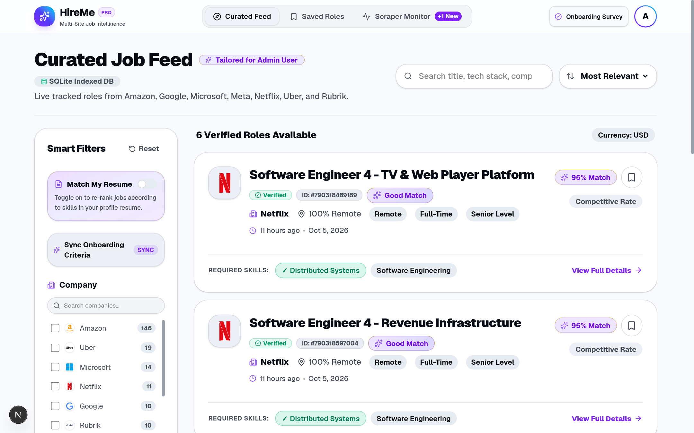
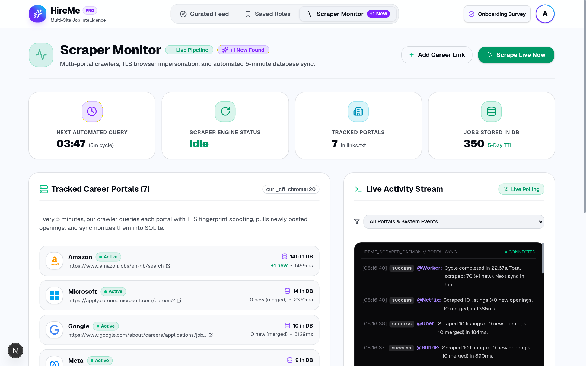
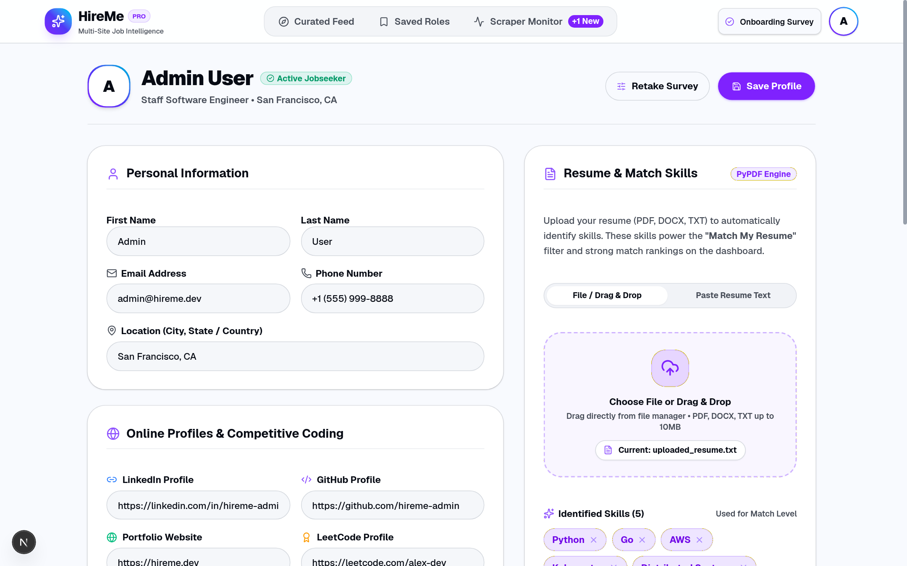
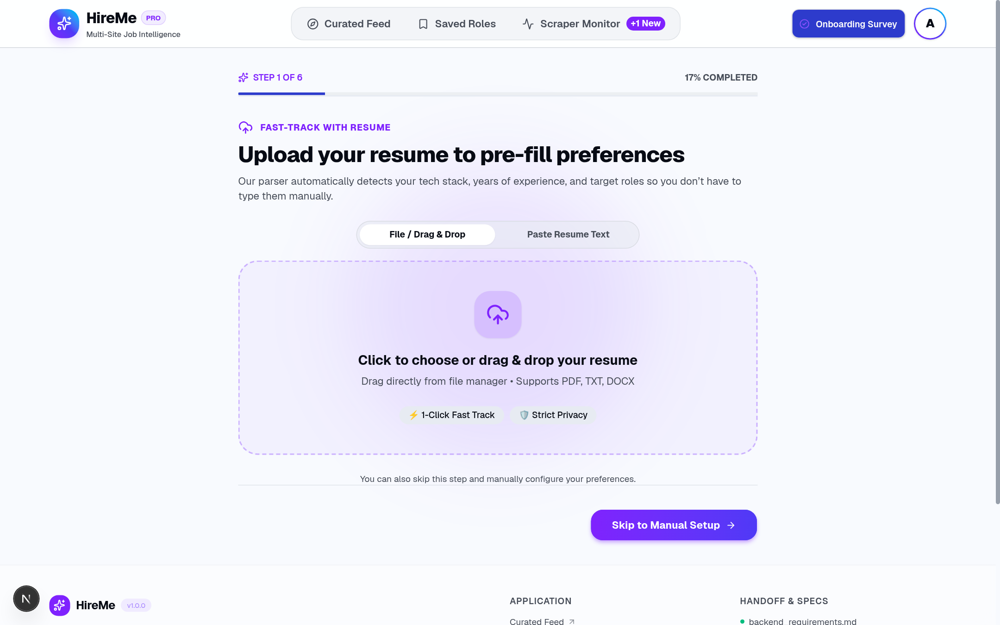

# HireMe 🚀

> **Personalized Multi-Site Job Aggregator with Direct ATS Ingestion & Real-Time Match Scoring**

HireMe solves job-search fatigue and aggregator spam by crawling career portals directly at the source (Amazon, Google, Microsoft, Meta, Netflix, Uber, Rubrik). It normalizes listings into a unified schema, deduplicates cross-platform postings, and pairs candidates with high-confidence roles using client-side preference vectors and an ATS-grade resume analyzer.

---

[](https://nextjs.org/)
[](https://react.dev/)
[](https://fastapi.tiangolo.com/)
[](https://python.org/)
[](https://www.typescriptlang.org/)
[](https://tailwindcss.com/)
[](https://www.sqlite.org/)

---

## 📸 Application Showcase

### 1. Curated Job Feed & Match Scoring
*Filter by verified direct-source roles, real-time match scores, company logos, salary floors, and remote preference.*


---

### 2. Live Scraper Monitor & Ingestion Telemetry
*Admin dashboard tracking multi-portal crawlers, TLS fingerprint latency, sync frequency, and real-time event logs.*


---

### 3. Resume & ATS Match Analyzer
*Upload PDF/DOCX resumes or paste text to extract technical skills and calculate match weights against live roles.*


---

### 4. Interactive Candidate Onboarding
*Granular preferences setup for target roles, seniority, compensation minimums, and tech stack.*


---

## ⚡ Key Features

- **Direct ATS & Career Site Ingestion**: Bypasses aggregator spam by scraping primary company career portals with `curl_cffi` TLS fingerprint impersonation (`chrome120`).
- **Cross-Platform Deduplication**: Intelligent 48-hour fuzzy matching engine that deduplicates identical roles across multi-region postings.
- **Sub-100ms Query Performance**: SQLite in WAL (Write-Ahead Logging) mode with an indexed job store and in-memory TTL query caching.
- **Resume Skill Extraction & ATS Matching**: Server-side PDF parser (`pypdf`) paired with keyword and skill extraction to score postings based on candidate background.
- **Autonomous Scraper Daemon**: Background worker running 5-minute crawl cycles across registered company adapters.
- **Modern Responsive UI**: Built with Next.js 16 (App Router), Tailwind CSS v4, Framer Motion, and Base UI components.

---

## 🏗️ Architecture Overview

```mermaid
flowchart TD
    subgraph Frontend ["Next.js 16 (React 19) — Port 3000"]
        UI[Curated Dashboard / Feed]
        Pref[Candidate Preferences & Onboarding]
        ResumeUI[ATS Resume Analyzer]
        AdminUI[Scraper Pipeline Telemetry]
    end

    subgraph Backend ["FastAPI — Port 8000"]
        API[FastAPI REST Endpoints]
        Cache[In-Memory Query Cache]
        DB[(SQLite DB — WAL Mode)]
        Worker[Background Worker Loop]
        ResumeEngine[PyPDF Skill Extraction Engine]
    end

    subgraph Pipeline ["Ingestion Pipeline (curl_cffi)"]
        Registry[Scraper Registry]
        Amazon[Amazon Jobs Adapter]
        Google[Google Careers Adapter]
        Microsoft[Microsoft Careers Adapter]
        Meta[Meta Careers Adapter]
        Netflix[Netflix Careers Adapter]
        Uber[Uber Careers Adapter]
        Rubrik[Rubrik Careers Adapter]
    end

    UI -->|REST / Cursor Pagination| API
    AdminUI -->|Telemetry / Trigger| API
    ResumeUI -->|Upload PDF / Text| API
    API --> Cache
    API --> DB
    API --> ResumeEngine

    Worker -->|Every 5 mins| Registry
    Registry --> Amazon & Google & Microsoft & Meta & Netflix & Uber & Rubrik
    Registry -->|Deduplicate & Upsert| DB
```



Detailed technical design, architecture diagrams, rules, and tracking are documented in:
- [System Architecture](docs/ARCHITECTURE.md)
- [System Architecture Diagram (Mermaid)](docs/ARCHITECTURE_DIAGRAM.md)
- [PlantUML Architecture Diagram](docs/ARCHITECTURE.puml)
- [Engineering Rules & Conventions](RULES.md)
- [Project Progress & Roadmap](PROGRESS.md)
- [Archived Backend Requirements](docs/history/backend_requirements_v1.md)

---

## 📁 Repository Structure

```
HireMe/
├── RULES.md                        # Project engineering standards & doc conventions
├── PROGRESS.md                     # Roadmap, phase progress & milestone tracking
├── README.md                       # Project overview & documentation
├── start.sh                        # Unified development starter script
│
├── backend/                        # FastAPI REST API & Ingestion Pipeline
│   ├── main.py                     # API router, CORS & endpoint definitions
│   ├── database.py                 # SQLite schema, indexing & deduplication
│   ├── worker.py                   # Periodic background scraper daemon
│   ├── filters.py                  # Cursor-based pagination & query filtering
│   ├── cache.py                    # In-memory query caching layer
│   ├── resume_analyzer.py          # PyPDF text extraction & skill analysis
│   ├── requirements.txt            # Python backend dependencies
│   ├── scrapers/                   # Modular company scrapers
│   │   ├── base.py                 # Base scraper interface & search filters
│   │   ├── amazon_scraper.py       # Amazon Jobs adapter
│   │   ├── google_scraper.py       # Google Careers adapter
│   │   ├── microsoft_scraper.py    # Microsoft Careers adapter
│   │   ├── meta_scraper.py         # Meta Careers adapter
│   │   ├── netflix_scraper.py      # Netflix Careers adapter
│   │   ├── uber_scraper.py         # Uber Careers adapter
│   │   └── rubrik_scraper.py       # Rubrik Careers adapter
│   ├── media/logos/                # Company SVG/PNG assets
│   └── sites/                      # Monitored URLs (links.txt, new_links.txt)
│
├── frontend/                       # Next.js 16 Web Application
│   ├── src/
│   │   ├── app/                    # App Router pages (dashboard, admin, history, profile)
│   │   ├── components/             # Reusable UI components & dialogs
│   │   ├── context/                # Preferences & Auth Context
│   │   ├── lib/                    # API client, logo & match-scoring utilities
│   │   └── types/                  # Strict TypeScript data contracts
│   ├── public/                     # Static assets & SVG icons
│   ├── package.json                # Frontend dependencies & scripts
│   └── tsconfig.json               # TypeScript configuration
│
├── docs/                           # Project Documentation & Assets
│   ├── ARCHITECTURE.md             # In-depth architectural specification
│   ├── ARCHITECTURE_DIAGRAM.md     # Clean Mermaid system architecture diagrams
│   ├── ARCHITECTURE.puml           # PlantUML system architecture diagram
│   ├── screenshots/                # Application screenshots
│   └── history/                    # Historical notes & previous iteration files
│       ├── README.md               # Summary of archived documents
│       ├── backend_requirements_v1.md # Initial v1 frontend handoff spec
│       ├── scraper_onboarding_prompt.md # Reverse-engineering LLM prompt
│       └── scraper_pipeline_notes.md # Early developer notes & TODOs
│
├── .env.example                    # Environment variable template
├── .gitignore                      # Git ignore rules (Python, Node, DB, caches)
└── pnpm-workspace.yaml             # PNPM monorepo workspace configuration
```

---

## 🚀 Quickstart

### Prerequisites

- **Node.js**: `v20.x` or later (tested on Node v24)
- **pnpm**: `v9.x` or later
- **Python**: `3.10+` (tested on Python 3.12/3.14)

### One-Command Launch (Recommended)

Run the unified startup script from the root of the repository:

```bash
chmod +x start.sh
./start.sh
```

This script will automatically:
1. Create and activate a Python virtual environment (`.venv`)
2. Install Python dependencies from `backend/requirements.txt`
3. Install frontend dependencies via `pnpm`
4. Launch the FastAPI backend on `http://localhost:8000`
5. Launch the Next.js development server on `http://localhost:3000`

---

### Manual Setup

#### 1. Backend (FastAPI)

```bash
cd backend
python3 -m venv .venv
source .venv/bin/activate
pip install -r requirements.txt

# Start the API server with live reloading
uvicorn main:app --reload --host 0.0.0.0 --port 8000
```

#### 2. Frontend (Next.js)

```bash
cd frontend
pnpm install

# Start the development server
pnpm dev
```

Visit `http://localhost:3000` in your browser.

---

## 📡 API Endpoints

| Method | Endpoint | Description |
|---|---|---|
| `GET` | `/api/health` | System health, indexed job count, cache hit rate & worker state |
| `GET` | `/api/v1/jobs` | Paginated and filtered job feed (supports query, seniority, roles, salary) |
| `GET` | `/api/v1/jobs/{id}` | Detailed job posting information |
| `POST` | `/api/v1/resume/parse` | Parse uploaded resume (PDF/TXT) and extract technical skills |
| `GET` | `/api/admin/scraper/status` | Crawler telemetry, active portals, and scraping log stream |
| `POST` | `/api/admin/scraper/trigger` | Manually trigger a scrape cycle across all registered portals |
| `POST` | `/api/admin/scraper/add-link` | Queue a new career site URL for onboarding |

Interactive Swagger documentation is available at `http://localhost:8000/docs`.

---

## 🔒 Environment Configuration

Copy the example configuration file:

```bash
cp .env.example .env
```

| Variable | Default | Purpose |
|---|---|---|
| `NEXT_PUBLIC_BACKEND_URL` | `http://localhost:8000` | Target FastAPI backend URL for client requests |

---

## 🛡️ License

This project is licensed under the [MIT License](LICENSE).
