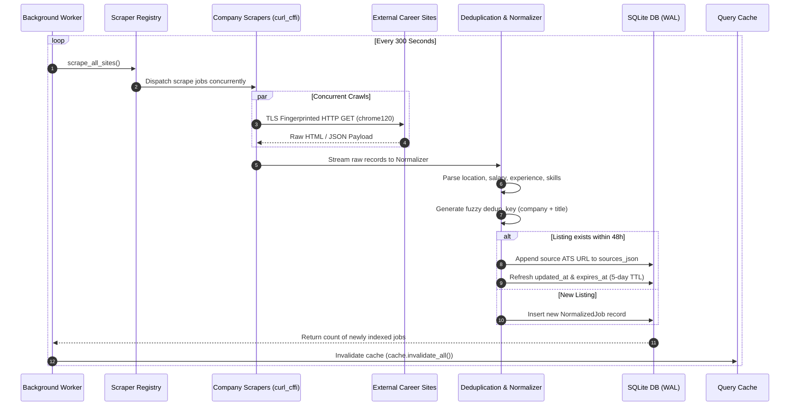
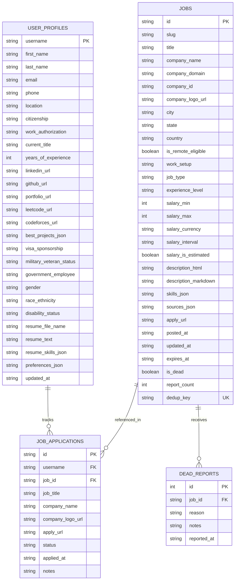

# HireMe — Clean Architecture Diagram

> **System Overview:** High-performance, multi-source job aggregator with direct ATS ingestion, cross-platform deduplication, candidate preference vector matching, and application history tracking.

---

## 1. System Topology & Component Interactions

```mermaid
flowchart TD
    %% Styling
    classDef client fill:#3b82f6,stroke:#1d4ed8,stroke-width:2px,color:#ffffff;
    classDef frontend fill:#1e293b,stroke:#3b82f6,stroke-width:2px,color:#f8fafc;
    classDef backend fill:#0f172a,stroke:#10b981,stroke-width:2px,color:#f8fafc;
    classDef storage fill:#1e1b4b,stroke:#8b5cf6,stroke-width:2px,color:#f8fafc;
    classDef pipeline fill:#312e81,stroke:#ec4899,stroke-width:2px,color:#f8fafc;
    classDef external fill:#1f2937,stroke:#64748b,stroke-width:1px,color:#e2e8f0;

    subgraph Client ["Client Browser"]
        User["Candidate / Admin User"]:::client
    end

    subgraph FE ["Frontend Layer (Next.js 16 · React 19 · Port 3000)"]
        Landing["/ Landing Page"]:::frontend
        Dashboard["/dashboard (Job Feed & Filters)"]:::frontend
        Admin["/admin (Scraper Telemetry & Control)"]:::frontend
        History["/history (Application Tracker)"]:::frontend
        Profile["/profile (Candidate Info & Resume)"]:::frontend
        JobDetail["/jobs/:id (Detail Sheet & Modal)"]:::frontend
        PrefCtx["PreferencesContext (LocalStorage Sync)"]:::frontend
        ScoreEngine["Client Match Scorer (matchScore.ts)"]:::frontend
        APIClient["API Client (lib/api.ts)"]:::frontend
    end

    subgraph BE ["Backend Layer (FastAPI · Uvicorn · Port 8000)"]
        Router["FastAPI Application (main.py)"]:::backend
        AuthModule["Auth & Admin Sudo (/api/v1/auth)"]:::backend
        JobsRouter["Jobs Search Engine (/api/v1/jobs)"]:::backend
        ProfileRouter["Profile & Skills API (/api/v1/user)"]:::backend
        AppsRouter["Application Tracker API (/api/v1/user/applications)"]:::backend
        AdminRouter["Scraper Telemetry API (/api/v1/admin/scraper)"]:::backend
        ResumeEngine["Resume Analyzer (pypdf + skill extractor)"]:::backend
        FilterEngine["Query Filter & Cursor Paginator (filters.py)"]:::backend
        QueryCache["In-Memory TTL Query Cache (cache.py)"]:::backend
        WorkerDaemon["Background Worker Daemon (worker.py)"]:::backend
    end

    subgraph DB ["Data & Persistence Layer"]
        SQLite[("SQLite Database (WAL Mode)
        - jobs (Indexed & Deduplicated)
        - user_profiles
        - job_applications
        - dead_reports")]:::storage
    end

    subgraph Ingestion ["Ingestion Pipeline (curl_cffi TLS Impersonation)"]
        Registry["Scraper Registry (scrapers/__init__.py)"]:::pipeline
        AmzScraper["Amazon Jobs Scraper"]:::pipeline
        GglScraper["Google Careers Scraper"]:::pipeline
        MsftScraper["Microsoft Careers Scraper"]:::pipeline
        MetaScraper["Meta Careers Scraper"]:::pipeline
        NflxScraper["Netflix Careers Scraper"]:::pipeline
        UberScraper["Uber Careers Scraper"]:::pipeline
        RubrikScraper["Rubrik Careers Scraper"]:::pipeline
    end

    subgraph Targets ["Target Career Portals"]
        ExtAmazon["amazon.jobs (WAF / CSRF protected)"]:::external
        ExtGoogle["google.com/about/careers"]:::external
        ExtMicrosoft["careers.microsoft.com"]:::external
        ExtMeta["metacareers.com"]:::external
        ExtNetflix["explore.jobs.netflix.net"]:::external
        ExtUber["jobs.uber.com"]:::external
        ExtRubrik["rubrik.com/careers"]:::external
    end

    %% User Interactions
    User -->|Views / Searches / Filters| Dashboard
    User -->|Monitors Scrapers & Crawlers| Admin
    User -->|Manages Applied Status| History
    User -->|Uploads Resume PDF / Links| Profile
    User -->|Views In-Depth Role| JobDetail

    %% Frontend Internal Flow
    Dashboard --> PrefCtx
    Dashboard --> ScoreEngine
    Dashboard --> APIClient
    Admin --> APIClient
    History --> APIClient
    Profile --> APIClient
    JobDetail --> APIClient

    %% Client to Backend
    APIClient -->|HTTP / JSON (REST)| Router

    %% Backend Routing
    Router --> JobsRouter
    Router --> ProfileRouter
    Router --> AppsRouter
    Router --> AdminRouter
    Router --> AuthModule

    %% Query & Persistence
    JobsRouter <--> QueryCache
    JobsRouter --> FilterEngine
    FilterEngine <--> SQLite
    ProfileRouter <--> SQLite
    ProfileRouter --> ResumeEngine
    AppsRouter <--> SQLite

    %% Scraping Cycle
    AdminRouter -->|Manual Trigger| WorkerDaemon
    WorkerDaemon -->|Runs every 5 mins| Registry
    Registry --> AmzScraper & GglScraper & MsftScraper & MetaScraper & NflxScraper & UberScraper & RubrikScraper
    
    %% Scraper Execution
    AmzScraper -->|chrome120 TLS| ExtAmazon
    GglScraper -->|chrome120 TLS| ExtGoogle
    MsftScraper -->|chrome120 TLS| ExtMicrosoft
    MetaScraper -->|chrome120 TLS| ExtMeta
    NflxScraper -->|chrome120 TLS| ExtNetflix
    UberScraper -->|chrome120 TLS| ExtUber
    RubrikScraper -->|chrome120 TLS| ExtRubrik

    %% Data Ingestion back to DB
    Registry -->|Deduplicate & Upsert| SQLite
    SQLite -.->|Invalidate on Write| QueryCache
```

---

## 2. Ingestion & Deduplication Pipeline Flow



---

## 3. Data Model & Entity Relationship Diagram


